# 复杂与非平面场景下基于运动引导的小型MAV检测

> **arXiv: 2410.10527v1 [cs.CV]，2024年10月14日** · 许可协议：CC BY-NC-SA 4.0
>
> **郭汉清（Hanqing Guo）**、**郑灿伦（Canlun Zheng）**、**赵世钰（Shiyu Zhao，通讯作者）**
>
> 郭汉清隶属于浙江大学计算机科学与技术学院，并同时任职于杭州西湖大学工学院（电子邮箱：guohanqing@westlake.edu.cn）。郑灿伦与赵世钰隶属于杭州西湖大学工学院（电子邮箱：zhaoshiyu@westlake.edu.cn）。

## 摘要

近年来，由于微型飞行器（MAV）在众多应用中的重要性，其视觉检测引起了越来越多的关注。然而，无论是基于外观特征还是基于运动特征的方法，在背景复杂或MAV过小时都会遇到困难。本文提出一种新颖的运动引导MAV检测器，能够在复杂与非平面场景中准确识别小型MAV。该检测器首先利用运动特征增强模块捕获小型MAV的运动特征；然后使用多目标跟踪与轨迹过滤来消除由运动视差造成的假正例；最后，采用基于外观的分类器与在裁剪区域上运行的基于外观的检测器，以获得精确的检测结果。由于我们提出的方法聚合了像素级运动特征，并同时基于MAV的运动与外观特征消除假正例，因此能够在动态且复杂的背景中高效准确地检测极小型MAV。在ARD-MAV数据集上的实验表明，该方法在具有挑战性的条件下实现了高性能的小型MAV检测，并在多种指标上优于其他最先进的方法。

**关键词：** 运动检测、MAV检测、多目标跟踪。

---

## 一、引言

近年来，基于视觉的空对空MAV检测因其在诸多任务中的应用而受到越来越多的关注，例如基于视觉的集群编队 [1]、空中感知与避让 [2] 以及恶意MAV检测 [3]。空对空MAV检测比一般的目标检测*更具挑战性*，因为相机在运动，而且当相机从上方俯视时，目标MAV常常被建筑、树木等复杂背景场景所吞没。此外，当从远处观察时，目标MAV在图像中可能极其微小。

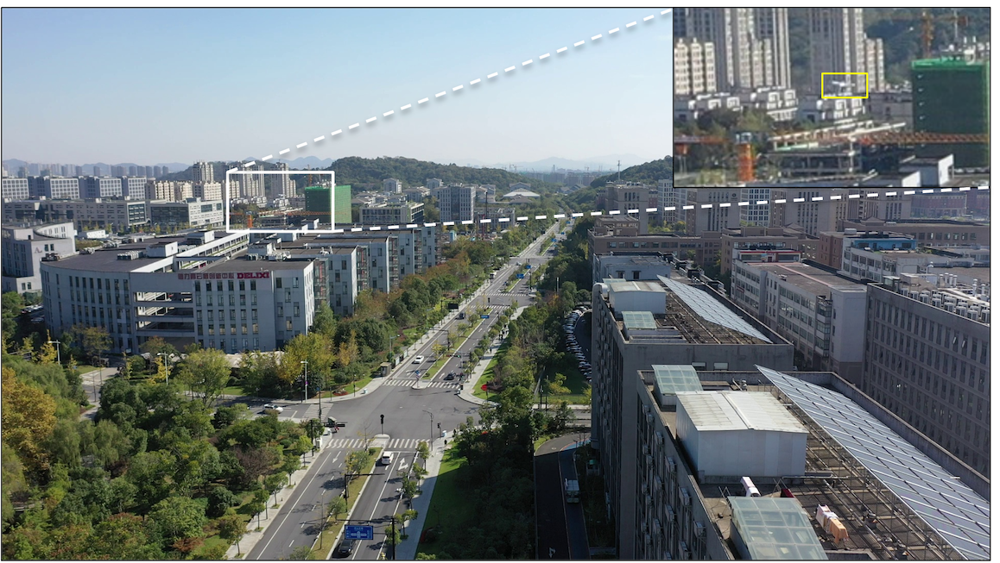

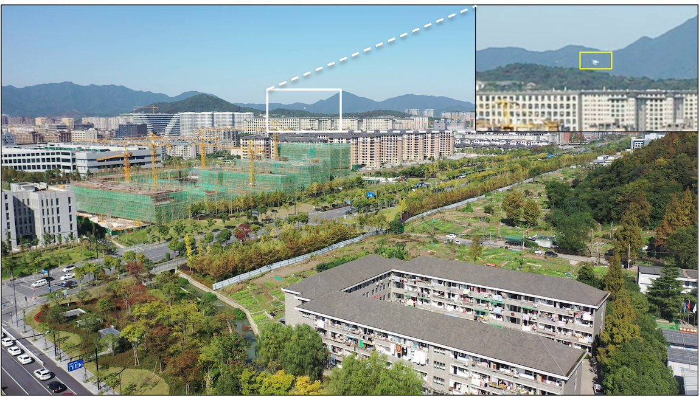

**图1：** MAV检测所面临挑战性条件的示例。在空对空MAV检测场景中，目标MAV常常被复杂背景吞没，或者在图像中极其微小。黄色方框圈出MAV。（右上角图像为放大300%后的更清晰视图。）

近年来，许多依赖深度学习技术的基于外观的方法被提出用于基于视觉的MAV检测。例如，一些最先进的目标检测网络，如YOLO系列、R-CNN系列、SSD和DETR，已被应用于MAV检测 [4]、[5]、[6]。这些方法在目标MAV与背景区分明显、且在图像中尺寸相对较大的相对简单场景下可以高效工作。然而，在更复杂的场景中，由于外观特征*不可靠*，它们往往会失效。例如，如图1(a)所示，当背景场景极其复杂时，目标MAV很容易被背景场景吞没。此外，当目标MAV飞离相机很远时，其图像可能只占据图像的一小部分。例如，如图1(b)所示，从约100米外观察到的MAV在1920×1080像素的图像中仅占据8×8像素。因此，必须开发高性能算法以在此类挑战性条件下检测MAV。

运动特征在挑战性条件下可以极大地帮助检测MAV。许多运动辅助方法将运动特征引入MAV检测，例如基于背景减除 [2]、[7]、低秩方法 [8]、[9]、时空信息 [10]、[11] 以及光流 [12]、[13] 等。然而，运动辅助MAV检测仍面临以下*挑战*。首先，当目标尺寸过小或背景过于复杂时，MAV的运动线索很难与背景分离。例如，我们测试了流行的光流模型RAFT [14] 用于运动特征提取。结果如图2所示，表明当目标与背景对比度高或目标足够大时，密集光流网络可以成功提取运动信息。然而，当背景复杂或目标较小时，运动信息几乎无法提取。其次，当相机运动时，图像对齐误差或视差效应的影响十分显著。现有的大多数运动辅助方法只处理*平面*背景 [2]、[7]、[15]，从而可以用仿射变换或二维透视变换来对齐相邻帧。虽然当相机在较高高度飞行、地面物体高度可忽略时，平面假设是有效的，但在飞行高度相对较低的许多情况下，该假设仍然无效。地面上的建筑、树木和路灯等物体会违反平面假设，产生大量假正例。

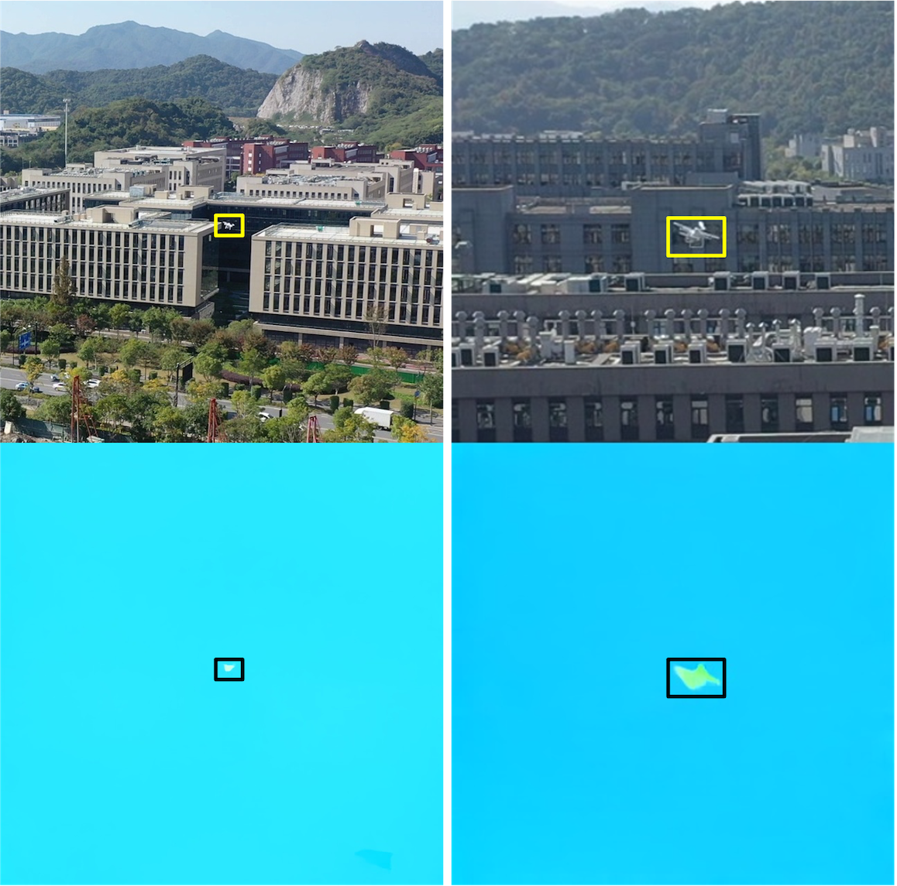

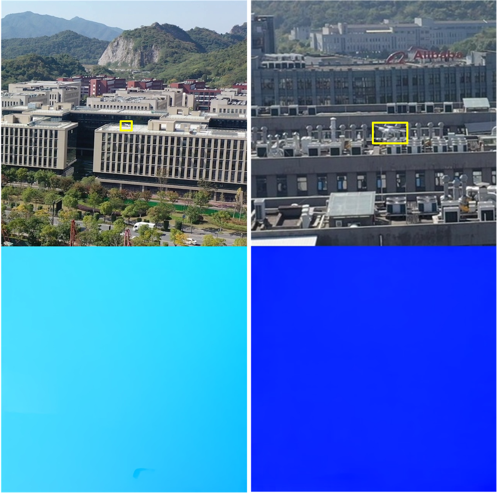

**图2：** 使用RAFT [14] 预训练模型提取运动MAV密集光流的测试结果。**黄色方框**表示MAV目标。**黑色方框**表示提取到的密集光流。

为克服现有方法的局限性，我们提出了一种运动引导的MAV检测器（MGMD），用于复杂与非平面场景下的小型MAV检测。该算法由三个模块组成：运动特征增强、轨迹过滤和局部精细检测。首先，应用运动特征增强模块从复杂背景中提取小型MAV的运动特征。其次，使用多目标跟踪为每个目标生成轨迹，并利用基于轨迹的分类器消除假正例。第三，采用基于外观的分类器和在裁剪区域上运行的基于外观的检测器，以获得精确的检测结果。

技术新颖性总结如下。

- 与传统的背景减除和光流方法相比，我们提出的运动特征增强模块能够从动态和复杂的背景中有效提取极小型MAV的运动特征。这是因为我们通过帧对齐和多帧差分来聚合像素级运动特征。我们提出的检测器在多种评估指标上优于 [12]、[16]、[17] 等最先进算法。
- 由运动视差产生的假正例的影响，可以通过多目标跟踪、轨迹过滤和基于外观的分类有效消除。这是因为我们提出的方法能够对MAV的时空特征进行建模，而这些特征不同于由运动视差产生的假正例。该方法的有效性已在ARD-MAV数据集上通过实验得到验证，该数据集中高楼、树木和路灯等三维结构占主导地位。

## 二、相关工作

### 2.1 基于视觉的MAV检测

近年来，基于视觉的MAV检测一直是一个热门话题。由于在通用目标检测上取得的巨大成功，一些研究者直接将最先进的目标检测网络应用于MAV检测。[5] 中的工作评估了八种最先进的深度学习算法在Det-Fly数据集上的MAV检测性能。类似地，[4] 中的作者在三个具有代表性的MAV数据集上评估了四种最先进的深度学习算法。为了进一步提高检测精度，[18] 中的作者提出了一种将迁移学习与自适应融合机制相结合的新方法，以提升小目标检测性能。然而，这些工作的实验结果表明，由于视觉特征不足，现有目标检测网络在复杂背景、运动模糊和小目标等挑战性条件下表现不佳。

为提高挑战性条件下的检测精度，运动特征被引入以辅助MAV检测。[19] 是使用运动相机检测飞行物体领域的早期工作。作者首先以滑动窗口方式使用两个CNN网络获取运动稳定的时空立方体，然后使用第三个CNN网络对每个时空立方体中的MAV进行分类。类似地，[7] 中的工作提出了一个无人机对无人机的视频数据集以及一种基于背景减除的小型无人机检测方法。随后，[12] 提出了一种基于两阶段分割的方法，用于从无人机视频中检测无人机，[13] 提出了一种基于特征超分辨率的无人机检测器，利用密集光流提取运动信息。近期，[20] 中的工作提出了一种端到端的无人机对无人机检测方法。作者利用CSPDarkNet53学习空间特征，并利用VideoSwin Transformer挖掘时间信息。当目标占据整幅图像的相对较大区域或背景相对简单时，这些方法可以正常工作。然而，在处理杂乱环境中的极小型目标（如10×10像素）时，检测精度会大幅下降。

### 2.2 航空图像中的小目标检测

近年来，航空图像中的目标检测一直是一项热门任务。由于目标尺寸极小且背景杂乱众多，通用目标检测算法在此类场景中通常表现不佳。[16] 尝试通过在YOLOv5上添加Transformer预测头和CBAM来提升无人机拍摄场景下的目标检测精度。[21] 中的工作提出了一种密集相似目标检测器，包含四个关键组件：粗检测器、自适应聚类过程、相似类分类器和精细检测器。近期，[22] 中的工作聚合了低分辨率图像中丰富的面向目标信息，以增强大规模图像中小目标的识别能力。此外，时间上下文也被引入以增强小目标特征。[23] 中的工作提出了一种新颖的两阶段时空CNN，有效且高效地结合了外观和运动信息。[24] 中的工作提出了一种基于YOLOv5的时空深度学习模型，通过一次性处理帧序列来利用时间上下文。虽然这些方法在某些小目标检测场景中被证明是有效的，但其对小型MAV检测的有效性尚未得到验证。此外，它们的计算成本对于实际应用来说通常难以接受。

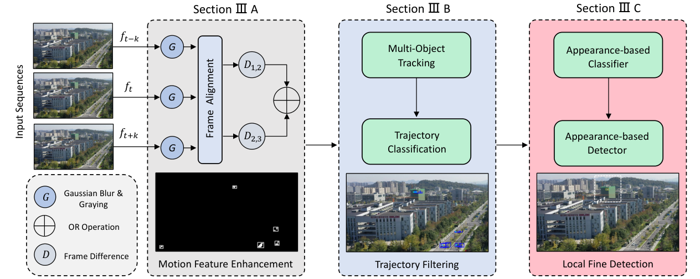

**图3：** 所提出的MGMD算法架构。首先，我们使用帧对齐和三帧差分从复杂背景中分割出运动物体。然后，应用多目标跟踪为每个检测生成轨迹，并使用基于轨迹的过滤器消除假正例。最后，利用局部基于外观的分类器和局部基于外观的检测器，在裁剪区域上获得精确的检测结果。

## 三、提出的方法

我们提出算法的架构如图3所示。它由三个模块组成：运动特征增强（MFE）、轨迹过滤（TF）和局部精细检测。以下各节将详细阐述每个模块。

### 3.1 运动特征增强

由于MAV在尺寸过小或背景过于复杂时难以检测，我们首先设计了一个运动特征增强模块，以获得可能包含运动MAV的潜在区域。

在相机自运动不明显的受限环境中，运动特征提取或运动物体检测是一个研究充分的问题。然而，当涉及无约束的自运动时，运动物体检测就变得困难得多。受相关工作 [7]、[25]、[26] 的启发，我们首先利用图像对齐技术获得稳定帧，然后执行帧差分和形态学操作，从多帧中分割运动物体。我们的运动特征增强模块可分为三个步骤：帧对齐、运动特征提取和后处理。

#### 3.1.1 帧对齐

为了将运动物体与动态背景分离开来，我们必须首先对齐连续帧，以消除相机自运动的影响。本文采用二维透视变换进行运动补偿，因为当背景源于三维世界中二维平面的相对运动时，它精确地建模了二维背景运动。原则上，透视变换要求背景是平面的或相机仅发生旋转。在某些情况下，这是一个合理的近似，因为MAV从高海拔俯瞰地面。然而，当飞行高度相对较低时，高楼、路灯、树木和电线杆等三维物体会显著影响运动补偿质量并产生大量假正例。尽管如此，我们提出的基于轨迹的过滤器和基于外观的分类器会被用来去除这些假正例。

为了保证计算效率，并在天空、草地等无纹理区域具有鲁棒性，我们使用基于网格的关键点而非特征检测器来计算单应矩阵。我们在前一帧的第 $k$ 帧上均匀采样 $30 \times 20$ 个关键点（分布在每行每列）。然后，通过金字塔卢卡斯-卡纳德（LK）算法跟踪这些关键点，以获得当前帧中对应的点。在两连续帧上匹配这些关键点之后，使用RANSAC方法计算单应矩阵 $H$ 以剔除异常值。前一 $k$ 帧的图像 $I_{t-k}$ 可以通过透视变换与当前帧 $I_{t}$ 对齐。

$$\hat{I}_{t-k} = \emph{H} I_{t-k} \tag{1}$$

这里，$H$ 表示 $I_{t-k}$ 与 $I_{t}$ 之间的透视变换矩阵，$\hat{I}_{t-k}$ 表示经过运动补偿的前 $k$ 帧图像。

#### 3.1.2 运动特征提取

在获得运动补偿后的前 $k$ 帧之后，我们可以通过当前帧与运动补偿后的前 $k$ 帧之间的绝对差分来突出运动区域。帧差分是一种简单但有效的发现变化的技术，它可以捕获图像之间的像素级变化。如果我们假设相邻帧之间的采样时间间隔很短，就可以预期这些差异源于明显运动的物体。一般来说，帧差分有许多不同的版本，如2帧差分、3帧差分和5帧差分。本文使用一种改进的3帧差分来提取运动特征。我们首先计算两个相邻帧之间的帧差分。帧差分定义如下：

$$E_{1,2} = |I_{t}-\hat{I}_{t-k}| \tag{2}$$

$$E_{2,3} = |I_{t}-\hat{I}_{t+k}| \tag{3}$$

其中 $I_{t}$ 是当前帧的灰度值，$\hat{I}_{t-k}$ 和 $\hat{I}_{t+k}$ 分别是运动补偿后的前 $k$ 帧和下一 $k$ 帧的灰度值。

接下来，基于大量实验，我们对 $E_{1,2}$ 和 $E_{2,3}$ 施加阈值为5的处理，以去除噪声并突出潜在运动物体的轮廓。由此获得两个二值化的帧差分图 $D_{1,2}$ 和 $D_{2,3}$。最后，对两个二值化帧差分掩码进行逻辑或（OR）运算以增强运动特征 $E_{t}$，公式如下：

$$E_{t} = D_{1,2} \cup D_{2,3} \tag{4}$$

与经典三帧差分方法使用逻辑与（AND）运算抑制噪声、获得更完整轮廓不同，逻辑或运算可以通过聚合多帧的运动区域来增强微小运动物体的运动特征。不同帧差分方法的详细比较将在第4.4节给出。

#### 3.1.3 后处理

帧差分能分割出属于运动物体的像素，但同时也存在许多噪声、小孔洞和断开的连通域。因此，使用形态学操作和连通域分析来获得更精确的边界框。首先，使用尺寸为3×3的结构元素迭代地进行形态学开运算和闭运算，以消除孤立像素并填补孔洞。然后，利用连通域分析获取每个物体的像素总数，并剔除小于15像素的连通域，因为如此小的物体通常属于干扰或对齐误差。最后，应用最小外接矩形来标记运动物体并获得最终的边界框。

### 3.2 轨迹过滤

在运动特征增强之后，我们获得了候选运动物体。然而，仍然存在许多假正例，如汽车、行人、摇摆的树木和图像对齐误差。特别是对于图像对齐误差，当MAV在城市区域低空飞行时，由运动视差产生的假正例十分严重。为了消除这些假正例，我们首先采用多目标跟踪为每个物体生成轨迹。然后，基于运动特征分析，通过轨迹分类来消除这些假正例。

#### 3.2.1 轨迹生成

为了为每个候选运动物体生成轨迹，我们采用经典的多目标跟踪算法SORT [27]。SORT使用带恒定速度运动模型的卡尔曼滤波器来预测当前帧中被跟踪物体的中心、尺寸和宽高比。数据关联被视为一个线性分配问题，可通过匈牙利算法 [28] 求解。如果某个检测与某个跟踪结果之间的交并比（IOU）超过0.3，则将该检测与该轨迹关联。否则，激活一个新的跟踪。每条轨迹的最大寿命（max age）设置为3。这意味着如果一条轨迹连续三帧未与任何检测关联，该轨迹将被删除。最小命中数（min-hits）设置为1，以便在成功检测后立即启动轨迹。

#### 3.2.2 轨迹分类

在上一步中，已通过多目标跟踪生成了候选运动物体的轨迹。为了去除属于图像对齐误差和摇摆树木的轨迹，我们提出了一种基于运动分析的轨迹分类算法。具体而言，所提出的轨迹分类模型主要考虑候选运动物体的时间特征和空间特征。

*1) 时间特征：* 通过观察运动物体和假正例的运动特征，我们发现MAV的运动通常是连续的并持续数帧。然而，摇摆树木和图像对齐误差等假正例的运动通常持续时间较短。因此，如果某个物体移动时间较长，我们赋予其较高的概率是运动物体。具体而言，我们将寿命超过3帧的物体视为潜在运动物体。

*2) 空间特征：* 另一方面，我们注意到假正例通常在小范围内移动。相比之下，行人、汽车和MAV等真实运动物体通常在较大范围内移动。因此，我们对连续帧之间距离较大的物体赋予较高的概率为MAV。具体而言，距离度量定义为

$$D(b_{i},b_{j})=\frac{\rho(b_{i},b_{j})}{d(b_{i},b_{j})} \tag{5}$$

其中 $b_{i}$ 和 $b_{j}$ 是同一物体在第 $i$ 帧和第 $j$ 帧的边界框，$\rho(b_{i},b_{j})$ 表示 $b_{i}$ 与 $b_{j}$ 中心之间的欧氏距离，$d(b_{i},b_{j})$ 表示 $b_{i}$ 与 $b_{j}$ 的最小包围框的对角线长度。

*3) 轨迹分类：* 计算每个目标为潜在运动目标或假正例的概率的算法细节见算法1。对于每个目标，我们定义 $S=\{s_{1},s_{2},...,s_{N}\}$ 为目标在 $N$ 帧内所有边界框的集合。我们首先通过前述透视变换将 $s_{N-3}$ 对齐到 $s_{N}$ 的帧。然后，计算 $s_{N-3}$ 与 $s_{N}$ 之间的距离度量，并直接根据距离度量的值将目标分类为运动物体或假正例。轨迹过滤的一个示例如图4所示。可以看到，路灯和树木等图像对齐误差大多被去除，而MAV、汽车和行人等真实运动物体被保留。

**算法1** 轨迹分类算法

```
输入： 潜在运动目标的边界框 m_i；
       该潜在运动目标已存储的 N 个边界框的集合 S={s_1, s_2, ..., s_N}；
输出： 潜在运动目标的概率 P；

1:  定义 f(·) 为统计集合大小的函数；
2:  将 m_i 放入 S 的末尾位置；
3:  如果 f(S) ≥ 3，则
4:      将 s_{N-3} 对齐到 s_N 所在的帧；
5:      计算 D(s_{N-3}, s_N)；
6:      P = { 1，若 D(s_{N-3}, s_N) ≥ 1；
            0，若 D(s_{N-3}, s_N) < 1 }；
7:  否则
8:      P = 0；
9:  结束条件判断
```

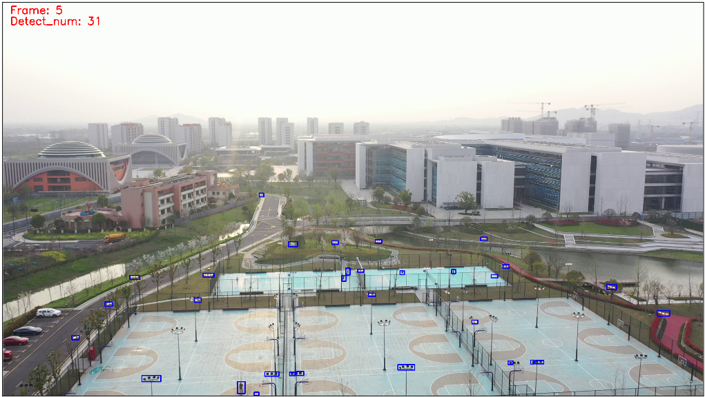

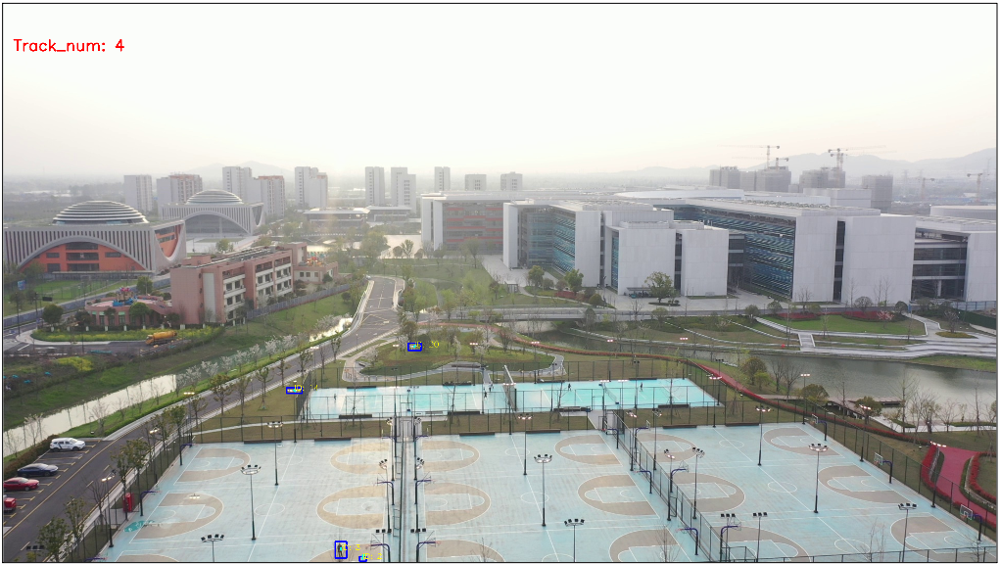

**图4：** 轨迹过滤示例。轨迹过滤之后，由图像对齐误差产生的大多数边界框被去除。

### 3.3 局部精细检测

在轨迹过滤之后，候选运动物体中仍包含一些假正例，如运动的汽车、行人、飞鸟和少量图像对齐误差。此外，由运动特征增强生成的边界框通常冗余，包含过多背景区域。因此，我们应用局部基于外观的分类器（LAC）和局部基于外观的检测器（LAD）来进一步消除假正例并获得精细化的边界框。

#### 3.3.1 局部基于外观的分类器

运动的汽车、行人和飞鸟等假正例通常与MAV具有相似的运动特征，但具有不同的外观特征，我们可以使用基于外观的分类器将它们分类为MAV和杂波。考虑到基于外观的分类器将被频繁调用，且大多数常见CNN架构层级很深、需要大量计算资源，我们使用一个三层CNN网络来提取MAV特征，并将候选运动物体分类为MAV和杂波。我们使用候选运动物体的局部图像来训练所提出的CNN模型。输入图像在送入网络之前被调整为32×32。每个卷积层使用ReLU激活和最大池化。最后一层使用带softmax激活的全连接层，将候选运动物体分成两类。

#### 3.3.2 局部基于外观的检测器

在上一步中，我们通过基于外观的分类器获得了候选MAV目标。然而，由于一些目标太小而无法识别，且浅层网络难以从MAV目标中提取足够的高层语义信息，候选MAV目标中仍包含一些与微小MAV外观相似的假正例。此外，通过形态学操作生成的边界框不够精确，且包含冗余的包围区域。因此，我们在从候选MAV目标邻近区域裁剪出的局部区域上应用基于外观的检测器，以获得精确的位置和最终的检测结果。

本文以候选MAV目标中心周围320×320的区域作为局部搜索区域进行裁剪。然后，将YOLOv5s应用于裁剪图像进行精细MAV检测。YOLO是一种基于卷积神经网络的快速单阶段目标检测器。我们先前的研究 [5] 表明，YOLO能够在精度与速度之间取得良好平衡。为了提高其在小目标检测上的性能，我们添加了一个小目标检测层，将浅层特征图与深层特征图拼接。局部检测器使用训练数据集中的裁剪图像进行训练，置信度超过0.5的目标被视为成功检测结果。

## 四、实验

### 4.1 数据集

现有的大多数MAV数据集要么由固定相机采集 [4]、[6]，要么目标尺寸相对较大、背景简单 [7]。据我们所知，专门用于从空中视角在复杂和非平面场景中进行小型MAV检测的数据集很少。为了评估所提出的MGMD算法的性能，我们在先前提出的ARD-MAV数据集[^1]上对该算法进行了测试。该数据集包含60个视频序列和106665帧。所有视频均由大疆Mavic2或大疆M300的相机在中低空飞行时拍摄。视频包含许多真实世界的挑战，如复杂背景、非平面场景、遮挡、相机突变运动、快速移动的MAV和小型MAV。每个视频约一分钟，帧率为30 FPS，分辨率为1920×1080。目标尺寸范围从6×3到136×75。平均目标尺寸仅为图像尺寸的0.02%。据我们所知，这是现有MAV数据集中最小的平均目标尺寸。我们使用50个视频进行训练，10个视频进行测试。特别地，测试视频主要由小型MAV和复杂背景下的MAV组成。

[^1]: https://github.com/WestlakeIntelligentRobotics/Global-Local-MAV-Detection

### 4.2 指标与实现细节

**指标。** 遵循相关工作 [12]，本实验基于精确率（precision）、召回率（recall）、F1分数（F1-Score）和平均精度（AP）等常用指标进行性能评估。由于该数据集中的目标过小，边界框位置的微小偏差会导致交并比（IOU）的大幅变化，我们将预测与真值之间的IOU阈值设置为0.25。因此，与真值匹配且IOU > 0.25的检测目标被计为真正例。

**实现细节。** 我们的实验在一台配备Intel i7处理器、32GB内存和NVIDIA Geforce RTX 3070 GPU的计算机上实现。对于局部精细检测器的训练，输入图像尺寸设置为320×320。我们使用Adam优化器，动量为0.937，初始学习率为0.01。训练从公开可用的YOLOv5s在MS-COCO上的预训练模型权重开始。对于基于外观的分类器，应用Adam优化器，学习率为0.001。我们以64的批大小训练了100个轮次。

### 4.3 与最先进方法的对比

我们将所提出的算法与近期发表的方法进行比较，如单阶段目标检测器、航空目标检测器 [16]、视频目标检测器 [17] 和航空小目标检测器 [12]。特别地，为避免下采样方法引入的分辨率损失，YOLOv5s、TPH-YOLOv5s和TPH-YOLOv5l使用1536×1536的输入图像尺寸进行推理，而非默认的640×640。所有对比方法均基于官方代码实现，并使用公开代码可用的预训练权重进行微调。

MGMD与对比方法在ARD-MAV数据集上的定量对比见表1。实验结果表明，我们提出的算法在多种指标上优于现有方法。具体而言，我们提出的方法在AP指标上比之前最好的方法高出19%。此外，我们的方法可以达到每秒28帧（FPS）的运行速度。

MGMD与对比方法的定性对比见图5。可以看到，我们提出的方法能够检测极其微小的MAV以及复杂背景下的MAV。然而，对比方法在如此具有挑战性的条件下几乎无法检测到目标MAV。需要强调的是，这里的小型MAV指的是尺寸小于10×10像素的MAV，即使是人类也难以在图像中识别。

**表1：** MGMD与ARD-MAV数据集上最先进方法的定量对比。

| 方法 | P | R | F1 | AP | FPS |
|---|---|---|---|---|---|
| YOLOv5s | 0.86 | 0.27 | 0.41 | 0.26 | **82** |
| TPH-YOLOv5s [16] | 0.81 | 0.30 | 0.44 | 0.34 | 35 |
| TPH-YOLOv5l [16] | **0.99** | 0.32 | 0.48 | 0.36 | 11 |
| Dogfight [12] | 0.77 | 0.24 | 0.36 | 0.24 | 1 |
| MEGA [17] | 0.26 | 0.37 | 0.31 | 0.23 | 3 |
| MGMD | 0.84 | **0.59** | **0.69** | **0.55** | 28 |

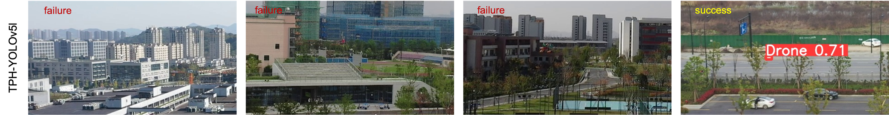

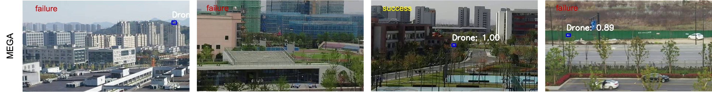

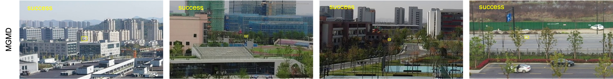

**图5：** TPH-YOLOv5l、MEGA与MGMD检测结果的定性对比。在挑战性条件下外观特征不可靠时，MGMD仍能检测到目标MAV。**黄色方框**表示我们方法检测到的目标。**红色方框**表示TPH-YOLOv5l检测到的目标。**蓝色方框**表示MEGA检测到的目标。由于图像尺寸相对于目标尺寸过大，我们仅展示全尺寸图像中的*裁剪区域*以便更清晰地观察。

### 4.4 消融研究

为了检验MGMD中不同组件的有效性，我们进行了大量实验，研究它们对最终性能的贡献。

**运动特征增强。** 我们测试了不同的帧差分方法，如2帧差分和经典3帧差分，以验证我们提出的运动特征增强模块的有效性。表2中的实验结果表明，我们提出的带OR运算的3帧差分能够有效提高召回率，同时以少量精确率和推理速度的损失为代价。

**表2：** 不同帧差分方法的消融研究。

| 方法 | P | R | F1 | FPS |
|---|---|---|---|---|
| 2帧差分 | 0.82 | 0.45 | 0.58 | **43** |
| 3帧差分 + AND | **0.87** | 0.46 | 0.61 | 33 |
| 3帧差分 + OR | 0.84 | **0.59** | **0.69** | 28 |

**轨迹过滤。** 本文主要使用TF模块去除非平面场景中摇摆树木和图像对齐误差等假正例。如表3所示，引入TF模块后，大多数情况下精确率和推理速度都得到了提升。然而，TF模块有时会降低召回率，因为它会错误地移除悬停或缓慢移动的MAV。

**局部基于外观的分类器。** 如表3第一行和第三行所示，LAC模块显著提高了检测精度和推理速度。这是因为LAC模块能够有效去除运动特征相似但外观与MAV明显不同的干扰物。因此，LAD模块的工作量大大减少，检测精度和推理速度都得到了提升。

**局部基于外观的检测器。** 如表3第二行和第三行所示，LAD通过提高精确率指标发挥了重要作用。由于LAC在运动特征增强生成的图像上工作，且由浅层网络训练，它很难区分与微小MAV外观相似且边界框粗糙的假正例。然而，LAD使用真值标签进行训练，具有边界框精化模块，并且对MAV具有更好的语义表示。因此，它可以通过消除与微小MAV外观相似的假正例来显著提高检测精度。

**表3：** MGMD中不同组件的消融研究。

| 方法 | P | R | F1 | FPS |
|---|---|---|---|---|
| MFE + LAD | 0.60 | 0.58 | 0.59 | 16 |
| MFE + LAC | 0.40 | 0.39 | 0.39 | **34** |
| MFE + LAD + LAC | 0.79 | **0.63** | **0.70** | 23 |
| MFE + TF + LAD | 0.79 | 0.58 | 0.67 | 22 |
| MFE + TF + LAC | 0.45 | 0.37 | 0.41 | 32 |
| MFE + TF + LAC + LAD | **0.84** | 0.59 | 0.69 | 28 |

### 4.5 讨论

实验结果表明，我们提出的方法在多种指标上优于最先进的方法。我们将此归因于几个因素。首先，MGMD采用运动特征增强模块提取运动信息，能够在目标极微小或背景复杂时检测目标MAV。然而，YOLOv5和TPH-YOLOv5等基于外观的检测器在这些场景中无法捕获外观特征。此外，[12] 等现有的基于运动的方法在此类挑战性条件下也存在困难。一些示例如图6所示。其次，MGMD使用局部精细检测器，该检测器在全尺寸图像裁剪出的局部搜索区域上工作。该局部搜索区域极大地保留了小目标的宝贵外观信息，并消除了其他外观相似干扰物的影响。因此，它在精确率指标上取得了更好的性能。第三，多目标跟踪方法充分利用了MAV的时间特征，消除了偶尔出现的干扰。

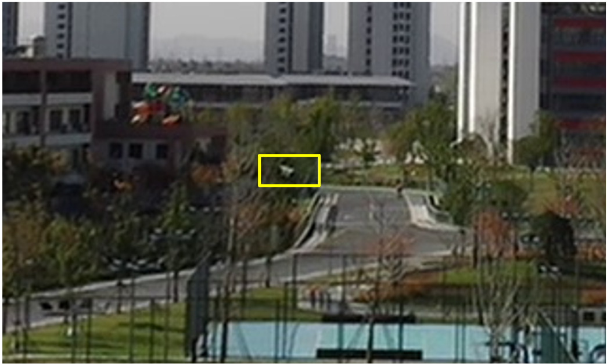

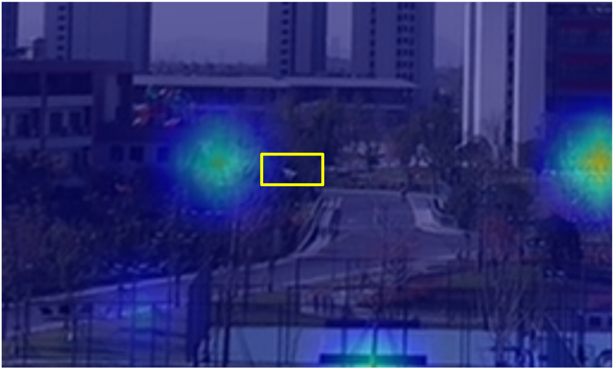

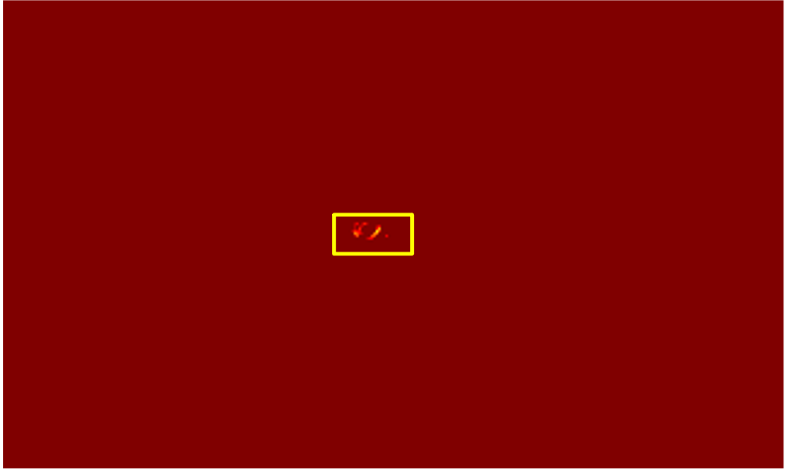

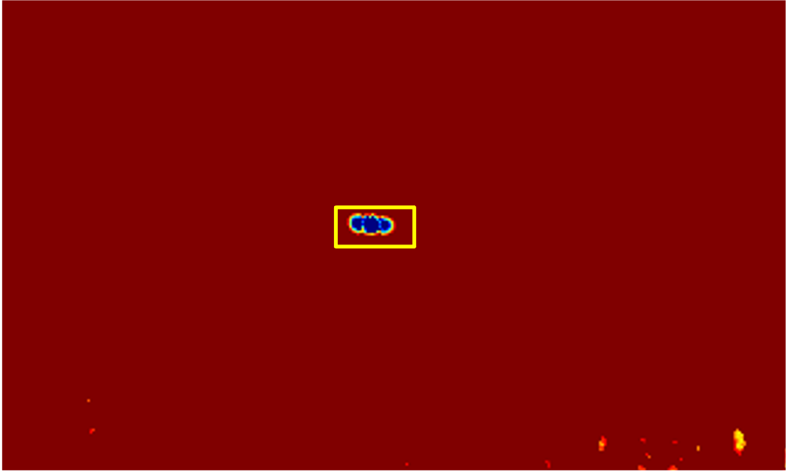

**图6：** 不同方法生成的外观特征与运动特征对比。(a) 输入图像。(b) YOLOv5的热力图。(c) 光流梯度提取的运动边界 [12]。(d) 我们方法提取的运动特征。

## 五、结论

本文针对复杂与非平面场景下的小型MAV检测，提出了一种简单而有效的算法。我们的主要贡献是使用所提出的运动特征增强模块提取极微小MAV的运动特征，然后利用基于轨迹的分类器和基于外观的分类器消除由运动视差和其他运动物体产生的假正例。此外，将改进的YOLOv5s应用于裁剪区域以实现精细化的检测结果。消融实验证明了我们方法中每个模块的有效性。综合来看，我们提出的算法在包含各种挑战性条件的ARD-MAV数据集上取得了0.55 AP的优异性能，运行速度达到28 FPS。

尽管所提出的方法取得了一定进展，但在检测与MAV高度相似的微小目标（如小鸟和汽车）时仍面临误检问题。此外，我们提出的方法主要关注运动目标，悬停和缓慢移动的MAV通常会被忽略。未来，我们将尝试将算法扩展到运动和悬停的MAV。此外，有必要设计一个端到端网络，在统一网络内学习运动线索和外观特征，以简化训练过程并减少经验参数。

## 致谢

这是在参考文献之前用于感谢那些对本文工作给予支持的个人和机构的一段简单段落。

## 参考文献

[1] Y. Tang, Y. Hu, J. Cui, F. Liao, M. Lao, F. Lin, and R. S. Teo, "Vision-aided multi-UAV autonomous flocking in GPS-denied environment," *IEEE Transactions on Industrial Electronics*, vol. 66, no. 1, pp. 616–626, 2018.

[2] J. Park and A. J. Choi, "Vision-based in-flight collision avoidance control based on background subtraction using embedded system," *Sensors*, vol. 23, no. 14, p. 6297, 2023.

[3] F. Samadzadegan, F. Dadrass Javan, F. Ashtari Mahini, and M. Gholamshahi, "Detection and recognition of drones based on a deep convolutional neural network using visible imagery," *Aerospace*, vol. 9, no. 1, pp. 31–51, 2022.

[4] B. K. S. Isaac-Medina, M. Poyser, D. Organisciak, C. G. Willcocks, T. P. Breckon, and H. P. H. Shum, "Unmanned aerial vehicle visual detection and tracking using deep neural networks: A performance benchmark," in *Proceedings of the 2021 IEEE/CVF International Conference on Computer Vision Workshops (ICCVW)*, pp. 1223–1232, 2021.

[5] Y. Zheng, Z. Chen, D. Lv, Z. Li, and S. Zhao, "Air-to-air visual detection of micro-UAVs: An experimental evaluation of deep learning," *IEEE Robotics and Automation Letters*, vol. 6, no. 2, pp. 1020–1027, 2021.

[6] J. Zhao, J. Zhang, D. Li, and D. Wang, "Vision-based anti-UAV detection and tracking," *IEEE Transactions on Intelligent Transportation Systems*, vol. 23, no. 12, pp. 25323–25334, 2022.

[7] J. Li, D. H. Ye, M. Kolsch, J. P. Wachs, and C. A. Bouman, "Fast and robust UAV to UAV detection and tracking from video," *IEEE Transactions on Emerging Topics in Computing*, vol. 10, no. 3, pp. 1519–1531, 2021.

[8] L. Du, C. Gao, Q. Feng, C. Wang, and J. Liu, "Small UAV detection in videos from a single moving camera," in *Proceedings of the 2017 CCCV Communications in Computer and Information Science (CCIS)*, pp. 187–197, 2017.

[9] C. Wang, T. Wang, E. Wang, E. Sun, and Z. Luo, "Flying small target detection for anti-UAV based on a gaussian mixture model in a compressive sensing domain," *Sensors*, vol. 19, no. 9, pp. 2168–2182, 2019.

[10] Y. Zheng, C. Zheng, X. Zhang, F. Chen, Z. Chen, and S. Zhao, "Detection, localization, and tracking of multiple MAVs with panoramic stereo camera networks," *IEEE Transactions on Automation Science and Engineering*, vol. 20, no. 2, pp. 1226–1243, 2022.

[11] J. Xie, C. Gao, J. Wu, Z. Shi, and J. Chen, "Small low-contrast target detection: Data-driven spatiotemporal feature fusion and implementation," *IEEE Transactions on Cybernetics*, vol. 52, no. 11, pp. 11847–11858, 2022.

[12] M. W. Ashraf, W. Sultani, and M. Shah, "Dogfight: Detecting drones from drones videos," in *Proceedings of the 2021 IEEE/CVF Conference on Computer Vision and Pattern Recognition (CVPR)*, pp. 7063–7072, 2021.

[13] H. Wang, X. Wang, C. Zhou, W. Meng, and Z. Shi, "Low in resolution, high in precision: UAV detection with super-resolution and motion information extraction," in *Proceedings of the IEEE International Conference on Acoustics, Speech and Signal Processing (ICASSP)*, pp. 1–5, IEEE, 2023.

[14] Z. Teed and J. Deng, "Raft: Recurrent all-pairs field transforms for optical flow," in *Proceedings of the 16th European Conference on Computer Vision (ECCV)*, pp. 402–419, Springer, 2020.

[15] P. Zhang, J. Zhao, C. Bo, D. Wang, H. Lu, and X. Yang, "Jointly modeling motion and appearance cues for robust RGB-T tracking," *IEEE Transactions on Image Processing*, vol. 30, pp. 3335–3347, 2021.

[16] X. Zhu, S. Lyu, X. Wang, and Q. Zhao, "TPH-YOLOv5: Improved YOLOv5 based on transformer prediction head for object detection on drone-captured scenarios," in *Proceedings of the 2021 IEEE/CVF International Conference on Computer Vision (ICCV) Workshops*, pp. 2778–2788, October 2021.

[17] Y. Chen, Y. Cao, H. Hu, and L. Wang, "Memory enhanced global-local aggregation for video object detection," in *Proceedings of the 2020 IEEE/CVF Conference on Computer Vision and Pattern Recognition (CVPR)*, pp. 10334–10343, 2020.

[18] C. Rui, G. Youwei, Z. Huafei, and J. Hongyu, "A comprehensive approach for UAV small object detection with simulation-based transfer learning and adaptive fusion," *arXiv preprint arXiv:2109.01800*, 2021.

[19] A. Rozantsev, V. Lepetit, and P. Fua, "Detecting flying objects using a single moving camera," *IEEE Transactions on Pattern Analysis and Machine Intelligence*, vol. 39, no. 5, pp. 879–892, 2016.

[20] T. Sangam, I. R. Dave, W. Sultani, and M. Shah, "Transvisdrone: Spatio-temporal transformer for vision-based drone-to-drone detection in aerial videos," in *Proceedings of the 2023 IEEE International Conference on Robotics and Automation (ICRA)*, pp. 6006–6013, IEEE, 2023.

[21] X. Wang, Y. Yan, H. Sun, and D. Zhu, "Dense-and-similar object detection in aerial images," *Pattern Recognition Letters*, vol. 176, pp. 153–159, 2023.

[22] C. Yang, Y. Cao, and X. Lu, "Towards better small object detection in UAV scenes: Aggregating more object-oriented information," *Pattern Recognition Letters*, vol. 182, pp. 24–30, 2024.

[23] R. LaLonde, D. Zhang, and M. Shah, "Clusternet: Detecting small objects in large scenes by exploiting spatio-temporal information," in *Proceedings of the IEEE Conference on Computer Vision and Pattern Recognition (CVPR)*, pp. 4003–4012, 2018.

[24] C. W. Corsel, M. van Lier, L. Kampmeijer, N. Boehrer, and E. M. Bakker, "Exploiting temporal context for tiny object detection," in *Proceedings of the IEEE/CVF Winter Conference on Applications of Computer Vision (WACV)*, pp. 79–89, 2023.

[25] S. Minaeian, J. Liu, and Y.-J. Son, "Effective and efficient detection of moving targets from a UAV's camera," *IEEE Transactions on Intelligent Transportation Systems*, vol. 19, no. 2, pp. 497–506, 2018.

[26] M. Ellenfeld, S. Moosbauer, R. Cardenes, U. Klauck, and M. Teutsch, "Deep fusion of appearance and frame differencing for motion segmentation," in *Proceedings of the IEEE/CVF Conference on Computer Vision and Pattern Recognition Workshops (CVPRW)*, pp. 4339–4349, 2021.

[27] A. Bewley, Z. Ge, L. Ott, F. Ramos, and B. Upcroft, "Simple online and realtime tracking," in *Proceedings of the 2016 IEEE International Conference on Image Processing (ICIP)*, pp. 3464–3468, 2016.

[28] H. W. Kuhn, "The hungarian method for the assignment problem," *Naval research logistics quarterly*, vol. 2, no. 1-2, pp. 83–97, 1955.