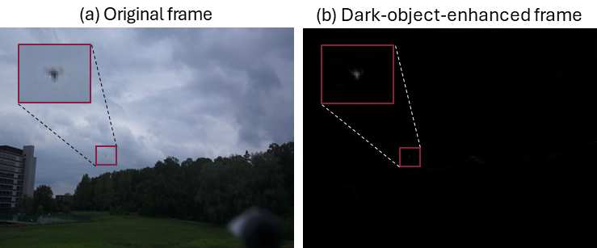

## SPA2D
原始帧 → [预处理:增强] → 增强帧D_t → [按候选速度平移+累加] → 累加图A_v → [取max] 最亮点=目标 → 输出位置
（挑出来在运动的）

增强帧疑似有点太重要了，一步就把目标弄出来了，这个是不是有点离谱了，

预处理会处理所有的符合目标特征的东西，包括背景里面的，但是只能跟踪单目标，所以可能会被背景的杂乱东西多的话会影响真正目标的追踪

背景再预处理阶段就已经去除掉了，所以如果相机移动的话也不会干扰到结果

没有特征，如何与其他目标进行区分，好像没办法，论文中也提到了

好像没有解决背景提出的问题啊，这怎么用的地面的数据啊。
## Motion-Guided Small MAV Detection in Complex and Non-Planar Scenes
运动特征增强（MFE）：先做锚点（关键点）配准对齐相邻帧，再对当前帧与前后对齐帧做多帧差分，用逻辑或（OR）聚合出相对背景运动的像素区域；之后后处理（形态学开闭 + 连通域分析），清理掉过小的相对背景运动像素块，得到候选目标框。
（挑出来运动看着像飞行器的）

轨迹过滤（TF）：用多目标跟踪（SORT）为每个候选生成轨迹，按轨迹筛选——剔除运动时间短、跨帧位移距离小的误检（去掉 3D 物体如灯柱/树木的运动视差误差）。

局部精细检测：对剩余的候选目标，先经外观分类器（LAC）筛掉与 MAV 运动相似但外观不同的物体（车、行人、飞鸟），再在裁剪的局部区域上用改进的 YOLOv5s 检测器（LAD）做精检测，得到最终结果。

光流方法在低对比度下不适用，所以为什么为什么关键点能处理无纹理区域

依旧是因为像素数太少，特征不明显，难以区分具体是什么，引入误差。

该方法对静止（悬停）目标的识别能力很弱，基本无法有效识别

## 后记
1. 卡尔曼滤波，一点不会，得看
2.  第二个比第一个多了多目标跟随，摄像机移动。但是感觉上要完善一点，第一个好像有点过度依赖图像预处理了，同时对复杂背景的情况也解决的不好。
3. 这东西真的能在无人机上跑起来吗，是不是有点太高看无人机的算力了
4. 多帧差分是要干什么，不懂（好像就是做差）
5. 一个是移动后对齐目标，一个是移动后对齐背景，对齐目标的天然就只能跟踪一个，但是对齐背景的就会好很多